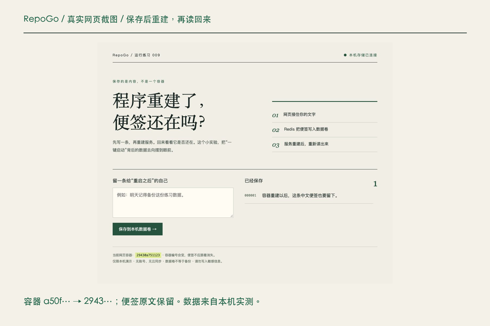

# 重建服务以后，便签还在吗？

一个 RepoGo 原创中文练习，用 Docker Compose 一起启动网页与 Redis。你可以保存一条便签，重建两个容器，再看原文是否仍在；随后暂停存储、观察 503，再恢复读取。

它适合已经能运行 Docker、但不确定应用数据放在哪里的读者。Compose 是“照一份配置组织多个服务启动”的工具；便签界面和练习代码由 RepoGo 编写，并非 Docker 官方产品。

## 先运行

需要可用的容器引擎、Docker Compose、Python 3.9+、联网下载镜像与 Python 依赖。没有 Docker 时先按 [部署说明](DEPLOY.md) 完成适用环境的安装；脚本不会安装引擎、接受条款或修改系统权限。

- macOS / Linux：在本目录运行 `bash start.sh`。
- Windows：在已启用 Linux 容器的 Docker 环境中运行 `start.cmd`。
- 等命令完成，打开 <http://127.0.0.1:18640/>，保存一条不含敏感信息的便签。

本次实测：macOS Apple Silicon、Docker Engine 29.8.0、Compose 5.5.1。Windows 未测；Linux 主机核心受阻（Slurm 计算节点无 Docker）。不是全平台已验证。

接着看 [START_HERE.md](START_HERE.md) 完成重建和断开恢复实验。停止用 `python3 run.py stop`，它会删除本练习容器和网络，**保留数据卷**。

## 交付与来源

RepoGo 原创交付维护仓库已公开，可匿名访问：<https://gitee.com/lushengjie/repogo-compose>。可见性说明更新于2026-10-31；原星球附件保留首发版本。

这里提供原创中文入口、Flask 应用、固定镜像摘要、带哈希的依赖锁、手册与排坑图。无第三方模型 API 或 GPU 需求；Docker Desktop 是否免费适用取决于组织与当前条款，计算机、网络和电费仍由使用者承担。

原项目：<https://github.com/docker/compose>（Apache-2.0）。本例使用 Redis 7.2 分支镜像（BSD-3-Clause）；没有打包上游程序或容器镜像。详细来源见 [ATTRIBUTION.md](ATTRIBUTION.md)。

仅本机、单用户学习演示，无登录、云同步或生产 SLA。数据卷不等于备份，勿放真实业务数据。AI 辅助编写，运行结果按实测记录。
