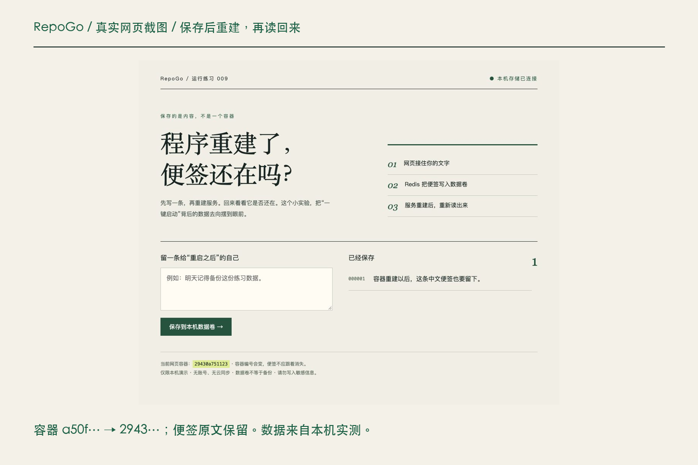
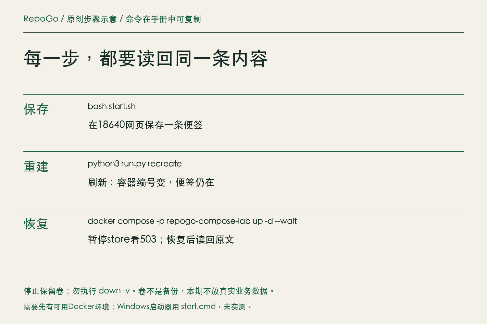

# 从一条便签，看懂服务与数据的区别

## 1. 保存你认识的内容

Mac/Linux 执行 `bash start.sh`；Windows 已具备 Linux 容器环境后运行 `start.cmd`。首次需要联网构建，完成后打开 <http://127.0.0.1:18640/>。

输入“容器重建以后，这条中文便签也要留下。”并保存。成功标志是“已经保存”增加，列表出现原文；记下页面底部的网页容器编号。这个编号代表一次运行中的实例，并不是便签的存储位置。



## 2. 重建两个服务，检查同一条内容

在同目录执行：

```sh
python3 run.py recreate
```

Windows 把 `python3` 改为 `py -3`。它调用：

```sh
docker compose -p repogo-compose-lab up -d --force-recreate --wait --wait-timeout 120
```

刷新网页。预期：网页容器编号改变，便签原文不变。这不是脚本重新填入样例：启动器没有预置任何便签；网页通过 Redis 从保留的 `repogo-compose-lab_notes` 数据卷中读取。

为什么有效？Compose 的 `notes:/data` 把 Redis 的数据目录接到具名数据卷；Redis 开启 AOF（把写入操作记到磁盘的日志），本例 `appendfsync always` 每次写入同步落盘，适合低流量教学，不代表高负载最佳设置。Compose 本身不会自动备份应用。

## 3. 看一眼“网页还在，存储断了”

```sh
docker compose -p repogo-compose-lab stop store
```

刷新网页，应该看到“网页还在，存储暂时断开了”，响应码是 HTTP 503。它表示当前无法读写，不表示数据已删除。然后执行：

```sh
docker compose -p repogo-compose-lab up -d --wait --wait-timeout 120
```

等待成功，刷新再读原便签。`depends_on` 的健康条件帮助安排启动顺序，并不会保证依赖永不故障；应用仍要处理断开情况。



## 4. 停止并重新开始

```sh
python3 run.py stop
python3 run.py start
```

停止调用 `down`，不带删除卷的选项。再次启动应读回原便签。不要执行 `down -v` 或全局清理卷的命令，它们会破坏这项保留数据的前提。脚本不提供“一键清空”。

## 本次真实观察

Mac ARM64 实跑：初始网页编号 `a50f3524b560`，强制重建后 `29430a751123`，同一条中文便签仍在；停存储返回 503，恢复后原文仍在。此处是一次本机实验，不是断电、磁盘损坏、跨主机迁移或线上容灾验证。

完整环境、端口和数据说明见 [DEPLOY.md](DEPLOY.md)，错误处理见 [FAQ.md](FAQ.md)。
